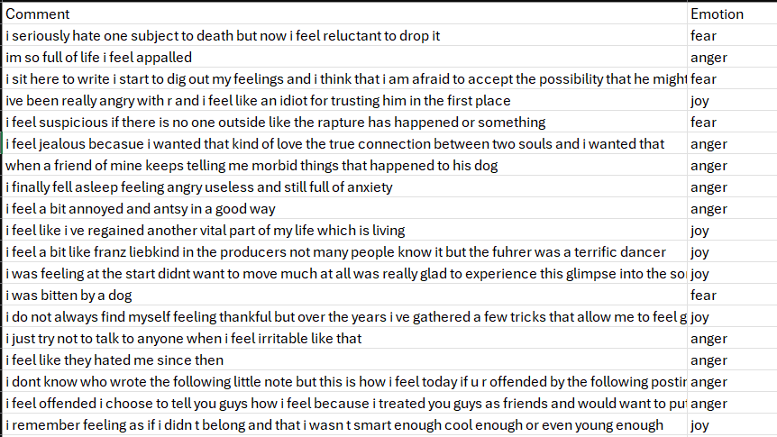
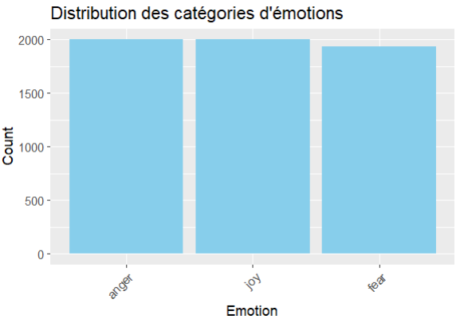
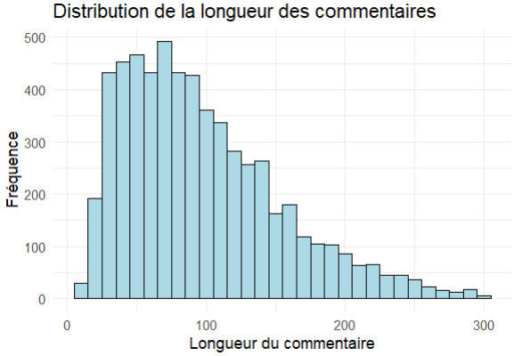
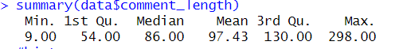
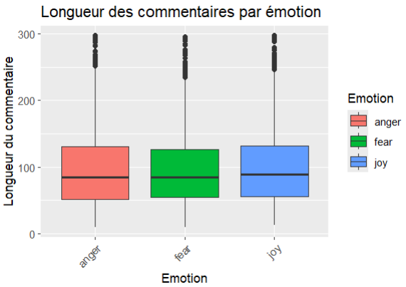
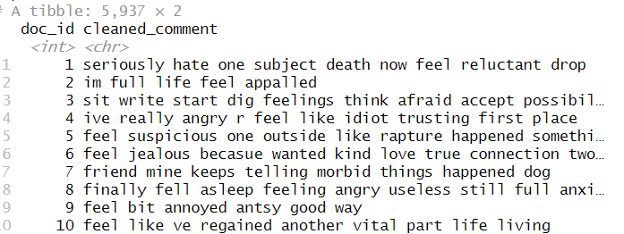
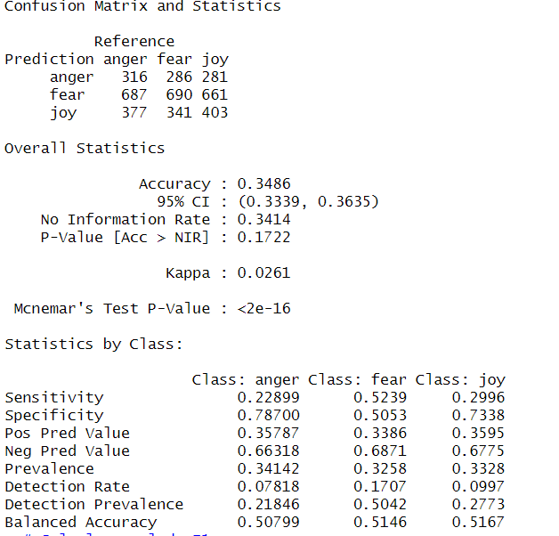
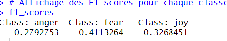

# Rapport du mini Projet1 :

## Auteur

- **groupe** : Camille Fahy, Aurélia Pesquet 


## Classification bayésienne
**[Fouille de données avec R--E4 AP-4209]** 

Résumé : Nous développerons un projet de classification bayésienne en utilisant l'ensemble de données sur les émotions (Kaggle) en plusieurs étapes. Nous allons employer une série de pré-traitement plus complexes et éventuellement étendre l'approche bayésienne pour inclure des ajustements (tuning) ou des probabilité supplémentaires. 

## Enseignant
**[Badr TAJINI]**

## Date de réalisation
**02/2025**

---

## Objectifs
Développer un classificateur bayésien pour prédire les émotions à partir de données textuelles.

---

## Environnement de travail
- **Langage utilisé** : *R*  
- **Outils nécessaires** : *RStudio, github*  
- **Source des données** : *Lien : Emotion Dataset (kaggle.com)*  

## Description des données 

Cet ensemble de données de classification des émotions est conçu pour faciliter la recherche et l'expérimentation dans le domaine du traitement du langage naturel et de l'analyse des émotions.
Il contient une collection diversifiée d'échantillons de texte, chacun étiqueté avec l'émotion correspondante qu'il transmet. Les émotions sont : le bonheur, la peur et la colère. Il possède 5934 valeurs et peut être utilisé pour l'analyse des sentiments, la classification des émotions, l'applications sensibles aux émotions, l'analyse des commentaires des clients, la surveillance des sentiments sur les réseaux sociaux ou la formation aux chatbots et aux assistants virtuels. 


Afin de mieux comprendre nos données et le sujet, nous avons chercher plus d'information sur ce qu'est une émotion. Une émotion peut être définie comme une réponse psychologique et comportementale provoquée par une situation. Elle s'exprime ici sous forme de données textuelles dans une phrase. Nous nous interressons ici à 3 émotions : "fear", "anger", "joy". Ces catégories servent de classes cibles pour le modèle bayésien. Les émotions sont caractérisée par des mots ou des expression. Toutefois classifier les émotions est un enjeu qui peut s'avérer complexe. En effet, un même mot peut exprimer plusieurs émotions. Le langage est parfois subtile et les humains peuvent utiliser des figures de style telles que l'ironie, les oxymores ... ce qui peut le rendre difficile à interpréter. 

---

## Résumé des travaux réalisés

1. **Étape 1** : *Chargement et exploration des données :*  

chargement des librairies nécessaires au traitement des données :
```r
library(SnowballC)       # Pour effectuer le stemming (réduction des mots à leur racine)
library(kableExtra)      # Pour créer des tableaux stylés dans les rapports (markdown/HTML)
library(dplyr)           # Pour manipuler les données (filtrage, regroupement, transformations)
library(ggplot2)         # Pour créer des visualisations graphiques
library(tidytext)        # Pour analyser les données textuelles (tokenization, etc.)
library(stringr)         # Pour manipuler les chaînes de caractères
library(tidyr)           # Pour transformer et organiser les données (pivot, unnest, etc.)
library(stopwords)       # Pour gérer les listes de mots vides (stop words)
library(tm)              # Pour effectuer des tâches de text mining (corpus, preprocessing, etc.)
library(textstem)        # Pour effectuer le lemmatization (réduction des mots à leur forme de base)
library(e1071)           # Pour les algorithmes de machine learning (SVM, naïve Bayes, etc.)
library(caret)           # Pour diviser les données en train/test et évaluer les modèles
library(stats)           # Pour les statistiques classiques et les tests (ex: tests d'hypothèse)
```

chargement et affichage des données : 

```r
data<-read.csv("G:/Mon Drive/E4/Fouille_de_donnees_avec_R/project1/archive (1)/Emotion_classify_Data.csv")
# Affichage des premières lignes sous forme de tableau HTML
data %>%
  kbl(digits = 3) %>%
  kable_styling(bootstrap_options = "striped", full_width = F, position = "center",
                latex_options = 'stripped') %>%
  scroll_box(height = "250px")
```

Nous effectuons ensuite une analyse exploratoire des données (EDA) pour comprendre la distribution des classes, la longueur des entrées de texte :

```r
ggplot(emotion_distribution, aes(x = reorder(Emotion, -count), y = count)) +
  geom_bar(stat = "identity", fill = "skyblue") +
  labs(x = "Emotion", y = "Count", title = "Distribution des catégories d'émotions") +
  theme(axis.text.x = element_text(angle = 45, hjust = 1))
```


On observe que les classes sont distribuées presque équitablement ce qui permet d'avoir un modèle robuste et d'éviter les biais. 

On analyse ensuite la distribution du nombre de caractères par commentaire


On obtient la distribution suivante :


Afin de voir si la longueur des commentaires est bien répartie par émotion, on réalise un boxplot :



On observe une répartion équitable par émotion ce qui va nous permettre de réaliser une analyse non biaisée en théorie. 

2. **Étape 2** : *Prétraitement des données* 

Nous allons d'abord nettoyer les données textuelles en supprimant les caractères spéciaux, les chiffres et les mots vides. Cela permet de rendre les données plus exploitables et d'obtenir de meilleurs résultats

```r
#nettoyage du texte
clean_text <- function(text) {
  text %>%
    # Convertir le texte en minuscules
    tolower() %>%
    # Supprimer les caractères spéciaux et les chiffres
    str_replace_all("[^a-z\\s]", "") %>%
    # Supprimer les chiffres
    str_replace_all("[0-9]", "") %>%
    # Supprimer les espaces excessifs
    str_replace_all("\\s+", " ") %>%
    # Supprimer les espaces en début et fin de chaîne
    str_trim()
}
```

Une fois le nettoyage appliqué, on supprime les mots vides. 
Cela permet de supprimer les mots qui apparaissent fréquements mais qui sont inutiles pour l'analyse des émotions tels que les articles. Cela permet de diminuer la taille des données sans perdre d'information. On ajoute certain mots personnalisés tels que ("not", "can", "will")

On tokenise en mots individuels afin diviser un texte en mots individuels, ce qui permet de rendre le texte plus manipulable pour les tâches d'analyse.

```r
cleaned_data <- data %>%
  mutate(doc_id = row_number()) %>% # Ajouter un identifiant unique pour chaque commentaire
  unnest_tokens(word, cleaned_comment) %>% # Diviser les commentaires en mots
  filter(!word %in% stop_words_list) # Supprimer les mots vides
  # Tokenisation
tokenized_data <- preprocessed_data %>%
  unnest_tokens(word, cleaned_comment.y)

```


On filtre les mots en fonction de leur fréquence relative pour éliminer les termes peu informatifs. 
 
```r
# Calcul des fréquences des mots
word_counts <- tokenized_data %>%
  count(word)
print(word_counts)
# Filtrer les mots en fonction de leur fréquence
filtered_words <- word_counts %>%
  filter(n > 0.0005 * nrow(tokenized_data) & n < 0.9 * nrow(tokenized_data))
print(filtered_words)
# Filtrer les données tokenisées pour ne garder que les mots les plus fréquents
tokenized_data <- tokenized_data %>%
  filter(word %in% filtered_words$word)
```
Il faut faire attention aux paramètres choisis en fonction de nos car ils peuvent fausser les résultats. 
 
On applique ensuite le TF-IDF ( term frequency-inverse document frequency) qui nous permet d'évaluer l'importance d'un terme dans nos textes. Le poids augmente proportionnellement au nombre d'occurrences du mot dans le texte. Il varie également en fonction de la répartition du mot dans le corpus. 

```r
# Calculer TF-IDF
tokenized_data <- tokenized_data %>%
  mutate(doc_id = as.character(doc_id))  # S'assurer que doc_id est une chaîne de caractères

tf_idf_data <- tokenized_data %>%
  count(doc_id, word) %>%  # Compter les occurrences des mots dans chaque document
  bind_tf_idf(term = word, document = doc_id, n = n)  # Calculer TF-IDF

# Trier par score TF-IDF décroissant
tf_idf_data <- tf_idf_data %>%
  arrange(desc(tf_idf))
print(tf_idf_data)
# Garder les 5000 mots avec les meilleurs scores TF-IDF
top_5000_words <- tf_idf_data %>%
  group_by(word) %>%
  summarise(max_tf_idf = max(tf_idf)) %>%
  arrange(desc(max_tf_idf)) %>%
  top_n(10000, max_tf_idf)

# Filtrer les données TF-IDF pour ne garder que les 1000 mots
tf_idf_data_filtered <- tf_idf_data %>%
  filter(word %in% top_5000_words$word)
print(tf_idf_data_filtered)
# Créer la matrice TF-IDF
tf_idf_matrix <- tf_idf_data_filtered %>%
  pivot_wider(
    names_from = word, 
    values_from = tf_idf, 
    values_fill = list(tf_idf = 0),  # Remplir les valeurs manquantes par 0
    names_repair = "unique"  # Corriger les noms dupliqués
  )

# Joindre les étiquettes d'Emotion
preprocessed_data <- preprocessed_data %>%
  mutate(doc_id = as.character(doc_id))

tf_idf_matrix <- tf_idf_matrix %>%
  left_join(preprocessed_data %>% select(doc_id, Emotion), by = "doc_id")
```

3. **Étape 3** : *Entraînement du modèle bayésien* 

Division des données en un jeu d'entrainement et de test : 
```r
# Diviser les données en train (80%) et test (20%)
set.seed(123)  # Pour reproductibilité
split <- createDataPartition(tf_idf_matrix$Emotion, p = 0.7, list = FALSE)
train_data <- tf_idf_matrix[split, ]
test_data <- tf_idf_matrix[-split, ]

```
Entrainement du model avec le modèle bayésien naif : 
```r
# Entraîner le modèle bayésien naïf
train_data_model <- train_data %>%
  select(-doc_id)  # Supprimer doc_id si présent
test_data_model <- test_data %>%
  select(-doc_id)  # Supprimer doc_id si présent
# Configurer la validation croisée à 10 plis
ctrl <- trainControl(method = "cv", number = 10, verboseIter = TRUE)
# Entraîner le modèle Naive Bayes avec validation croisée
naive_model_cv <- train(Emotion ~ ., data = train_data_model, 
                        method = "naive_bayes", 
                        trControl = ctrl, 
                        tuneLength = 5,
)
```

On applique la validation croisée pour tirer plusieurs ensemble de validation de notre base de données et obtenir une estimation plus robuste avec un meilleur compormis biais variance. On choisit 10 folds. 

On prédit alors les résultats sur les données de test. 

```r
# Prédictions avec le modèle validé par croisée
test_predictions <- predict(naive_model_cv, newdata = test_data_model)
# Convertir test_predictions et test_data_model$Emotion en facteurs avec les mêmes niveaux
levels_emotion <- levels(factor(train_data_model$Emotion))  # Niveaux des émotions dans les données d'entraînement

# Convertir les prédictions et les vraies étiquettes en facteurs avec les mêmes niveaux
test_predictions <- factor(test_predictions, levels = levels_emotion)
test_data_model$Emotion <- factor(test_data_model$Emotion, levels = levels_emotion)
```

4. **Étape 4** : *Évaluation du modèle* 

On évalue le modèle à l'aide de la matrice de confusion : 



Statistiques globales :

La précision globale est de 0.3486 (environ 34.9%). Cela signifie que le modèle prédit correctement 34.9% des échantillons. Ce taux de précision est plutôt faible. Malheureusement, notre modèle ne prédit pas bien la structure des données. 

La valeur de Kappa (0.0261) est proche de zéro, ce qui indique que le modèle n’a que très peu d’accord avec les vraies étiquettes après avoir pris en compte la chance. Un Kappa proche de zéro indique une performance aléatoire.

Le P-Value de Mcnemar's Test est inférieur à 2e-16, ce qui indique une différence significative dans les erreurs de classification entre les classes. Cela peut suggérer que le modèle est plus susceptible de faire des erreurs dans certaines classes (probablement en raison des similitudes dans les caractéristiques des émotions).

Si on regarde les statistiques par classe :

On voit pour la classe colère que le rappel est de 0.229. C’est relativement faible et indique que le modèle a du mal à capturer cette émotion. La spécificité est 0.787 ce qui signifie que le modèle réussit à classer correctement les exemples non "anger" dans environ 78.7% des cas, ce qui est relativement élevé. Lorsque le modèle prédit "anger", il a une chance de 35.8% d'être correct. Le modèle prédit mal la classe colère. 

On voit pour la classe peur que le rappel est meilleur. Le modèle réussit à identifier environ 52.4% des échantillons de la classe "fear", ce qui est modéré, mais montre que la classe "fear" est mieux capturée que "anger" et "joy". La spécificité est de 0.505. La précision est 0.339. Le blanced accuracy est égal à 0.514. 

La classe "joy" est prédite avec un rappel de 30%. La spécificité est égal à 0.734, la précision est égale à 0.36. Le balanced accuracy est de 0.517. 

On en conclu que le modèle semble prédire fear de manière plus efficace que pour les autre émotion mais globalement le modèle à du mal à capturer les émotions. 
Cela peut être en partie du au fait que les émotions sont des sentiments subjectifs et que le langage pour les exprimer est complexe, ce qui est difficile à modéliser pour un modèle bayesien. 

On calcule aussi le F1 score qui mesure la performance d'un modèle de classification qui combine à la fois la précision (precision) et le rappel (recall)

 

Les F1 scores sont relativement faibles pour toutes les classes, ce qui suggère que votre modèle a des difficultés à bien classer les données dans chacune des catégories.

5. **Étape 5** : *Amélioration et optimisation*  

---
Nous pourrions tenter d'améliorer notre modèle grâce à l'amélioration du prétraitement des données en testant d'autres approches de prétraitement du texte, comme l'ajout de n-grams (bigrams/trigrams) ou l'amélioration de la lemmatisation/stemming.

Nous pourriions aussi explorer d'autres modèles que Naive Bayes et tenter d'affiner les hyperparamètres. 

---

## 📂 Organisation des fichiers
- `projet1.R` : *Script principal utilisé pour le modèle de classification*  
- `Emotion_classify_Data.csv` : *Jeu de données utilisé dans le mini projet*  
- `README.md` : *rapport détaillé*  

---


