# 1. Préambule

## Contexte de la détection de texte généré par l'IA

La détection de texte généré par l'IA devient une question cruciale à mesure que les modèles de langage produisent des écrits de plus en plus réalistes. La capacité de distinguer le texte généré par des machines de celui écrit par des humains peut avoir des applications importantes dans des domaines comme l'éducation, les médias et la cybersécurité. Ceci constitue un un défi intéressant pour la classification bayésienne. 

## Objectifs de l’utilisation de la classification bayésienne et de l’AFD

L'objectif principal de cette analyse est de développer un modèle qui puisse classer un texte comme étant généré par un humain ou une machine. Nous extrairons les caractéristiques des données, nous réduirons la dimensionalité de l'espace des caractéritiques  tout en préservant la possibilité de différencier les classes grâce à **l'Analyse Factorielle Discriminante (AFD)**. Puis, nous entrainerons **un modèle bayésien** et évaluerons le modèle. L'entraînement d'un modèle bayésien consistera à ajuster ses paramètres en fonction des données disponibles afin de pouvoir faire des inférences ou des prédictions robustes sur des données futures. On cherchera à obtenir une disttribution à posteriori des paramètres et ainsi de modéliser l'incertitude sur les paramètres du modèle. 

# 2. Données et prétraitement

**1- Description du jeu de données**

Le jeu de données utilisé dans cette analyse est composé de textes étiquetés, où chaque exemple est marqué comme étant soit écrit par un humain, soit généré par une IA. Le fichier que nous utilisons "train_drcat_04.csv" contient les colones suivantes : "essay_id", "text", "label", "source", "prompt". 

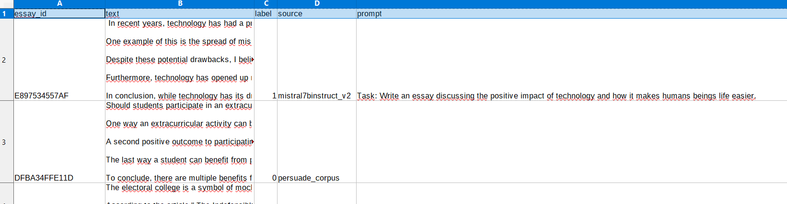

La première colonne contient l'identifiant du text. La deuxième le texte. La troisième le label, 0 correspond à un texte écrit par un humain et 1 correspond à un texte écrit pas un llm. La quatrième colonne "prompt" correspond au prompt renseigné dans le llm dans le cas ou le texte à été généré par un llm.
Ces données proviennent d'un concours Kaggle "LLM-Detect" : https://www.kaggle.com/competitions/llm-detect-ai-generated-text


**2- Lecture du fichier csv**
```R
#Chargement des données
data<-read.csv("datasets/train_drcat_04.csv")

#Analyse exploratoire
head(data)

# Résumé statistique des variables
summary(data)

```

**3- Vérification des valeurs manquantes**
```R
# Vérifier les valeurs manquantes
colSums(is.na(data))
```
**4-Séparation du jeu de données en un ensemble de test et d'entrainement.**
Pour ne pas contaminer les données d'entrainement et de test, on fera l'extraction des features, la lda et l'entrainement du modèle sur le jeu d'entrainement. 

```R
# Séparer les données en jeu d'entraînement (70%) et jeu de test (30%)
set.seed(123)  # Pour la reproductibilité
train_index <- createDataPartition(data$label, p = 0.7, list = FALSE)

train_data <- data[train_index, ]
test_data <- data[-train_index, ]
```

**5- Analyse Exploratoire** : 

 Analyse de la distribution des classes :

On observe que les classes ne sont pas équilibrées, cela peut induire des biais. On peut par exemple observer un biais vers la classe majoritaire qui aboutit à une précision élevée mais un très mauvaise performance sur la classe minoritaire. C'est ce qui nous ait arrivé dans un premier temps. Nous avions une accuracy de 78% mais une très mauvaise prédiction de la classe générée par un llm avec une sensibilité de 20%.

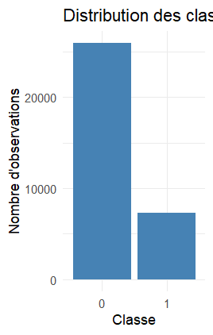 

Pour cela, nous avons séparés les classe et sous échantilloné la classe majoritaire, ici la classe 0 (humain). Puis nous avons rassemblé les données.

# 3. Extraction des caractéristiques (Feature Extraction) : 

Nous allons maintenant extraire les caractéristiques linguistiques et stylométriques connues pour différer entre le texte généré par l’homme et le texte généré par l’IA.

**1- Etude de la longueur des textes**

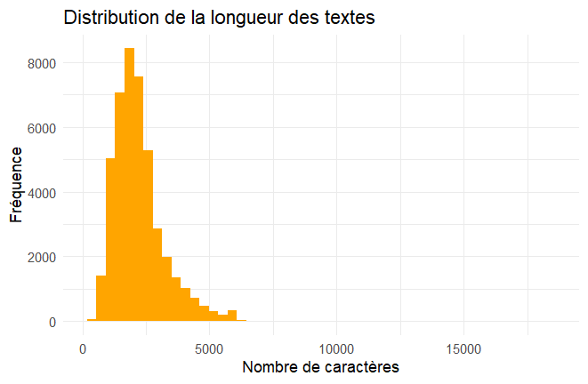

**2- Etude de la fréquence des mots**

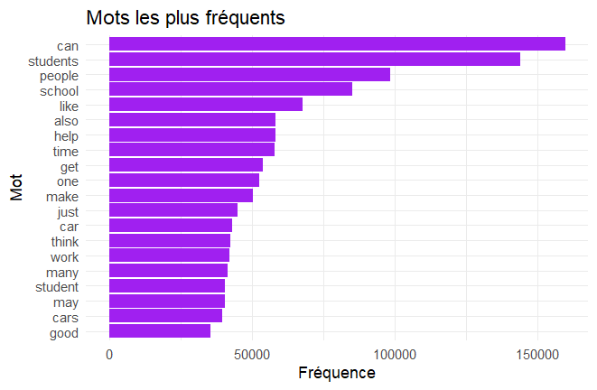

On peut supposer que le dataset traite principalement de sujets tels comme l'éducation, les sciences sociales ou les voitures.

**3- Comparaison des longueurs de texte par classe**

On veut voir si on peut distinguer les textes humains ou générés par IA en fonction de la longueur des textes par classe. On obtient le box blot suivant : 

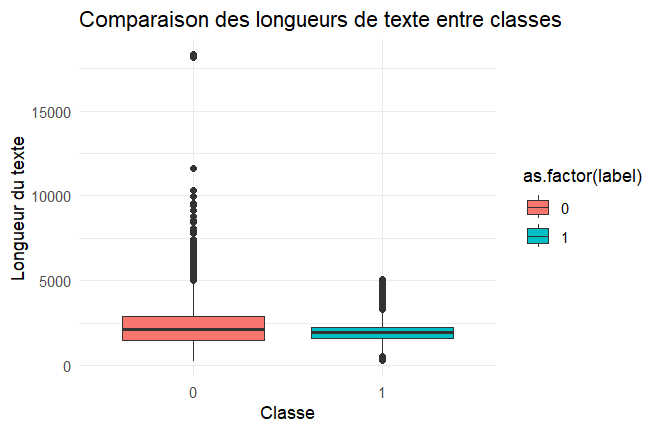

On ajoute une colonne word_count qui nous permettra d'utiliser ce paramètre pour réaliser plus tard la lda. 

**4- étude de la variabilité de la longueur de phrase**
 
 On calcule la longueure moyenne des phrases. 

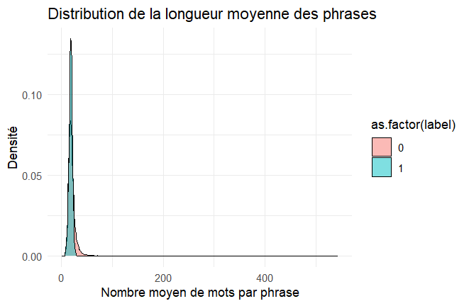

**5- calcul des scores de lisibilité**

Le score de lisibilité de Flesch-Kincaid est un score basé sur le nombre de mot, de phrases et de sylable. Plus le score est élévé, plus le texte est facile à lire. 

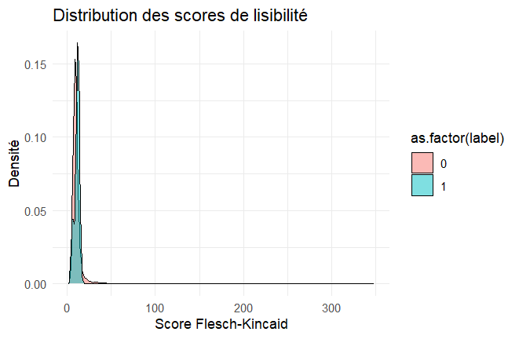

On peut voir que le texte généré par un llm semble plus facile à lire que ceux écrit par un humain. 

**6- Type-Token Ratio (TTR)**

Le TTR permet de mesurer la diversité lexicale d'un texte. La formule du TTR est : TTR=nombre de mots uniques/nombre total de mots. Plus le score est élevé, plus  

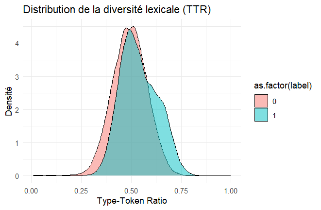

**7- Observation des mots les plus fréquents en fonction des labels**

Pour observer les champs lexicaux des textes générés par ia et ceux par un humain, on va séparer les textes par classes, supprimer les mots vides puis tokeniser les textes et compter les mots fréquents. On extrait ensuite les mots les plus fréquents pour chaque label. On compte dans chaque texte l'apparition des mots caratéristiques. On peut visualiser l'apparition des ces mots caractéristiques. 
nombre de mots apparaissant 

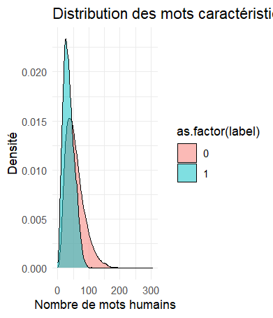

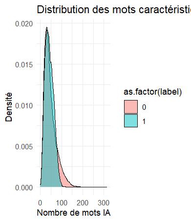

**8- Calcul de la perplexité** 

-**Tokenisation des textes** : Découpage du texte en tokens (mots, ponctuation). Les options remove_punct = TRUE et remove_symbols = TRUE indiquent la suppression des ponctuations et des symboles.

```R
tokens <- tokens(data_balanced$text, remove_punct = TRUE, remove_symbols = TRUE)

```
-**Extraction des bigrammes** : La fonction unnest_tokens() extrait des bigrammes (séquences de deux mots consécutifs) à partir du texte.
La fonction count() permet de compter l'occurrence de chaque bigramme et de les trier par fréquence (sort = TRUE).
Cette étape est utile pour identifier des motifs récurrents dans les textes.

```R
bigrams <- data_balanced %>%
  unnest_tokens(bigram, text, token = "ngrams", n = 2) %>%
  count(bigram, sort = TRUE)

```
-**Création d'un corpus de texte** : Cette ligne transforme la colonne text en un corpus, une structure adaptée pour la manipulation de texte dans quanteda.
```R
text_corpus <- corpus(data_balanced$text)
```
-**Création d'un Document Feature Matrix (DFM)** : Un Document-Feature Matrix (DFM) est une matrice où chaque ligne représente un document et chaque colonne une caractéristique (comme un mot).
Les valeurs dans la matrice sont les occurrences des mots.
```R
dfm_matrix <- dfm(tokens(text_corpus), remove_punct = TRUE, remove_numbers = TRUE)
```
-**Modélisation des bigrammes**
```R
bigram_model <- dfm(tokens(text_corpus), ngrams = 2)
```
-**Calcul de la perplexité** : La perplexité mesure la difficulté pour un modèle de prédire un texte donné. Plus elle est faible, plus le texte est prévisible.
```R
compute_perplexity <- function(texts) {
  vocabulary <- create_vocabulary(itoken(texts, progressbar = FALSE))
  vectorizer <- vocab_vectorizer(vocabulary)
  dtm <- create_dtm(itoken(texts), vectorizer)
  
  term_prob <- colSums(dtm) / sum(dtm)
  perplexity <- exp(-mean(log(term_prob[term_prob > 0])))
  return(perplexity)
}

```
On créer un vocabulaire (create_vocabulary) à partir des textes. Puis, on construit une matrice document-terme (create_dtm).On calcule les probabilités des termes (term_prob).Enfin, on calcul de la perplexité comme l'exponentielle de la moyenne négative des logarithmes des probabilités des termes.

```R
data_balanced$perplexity <- sapply(data_balanced$text, compute_perplexity)
```
On applique la fonction compute_perplexity() à chaque texte de data_balanced$text et on stocke les valeurs de perplexité dans une nouvelle colonne perplexity.


# 4 Analyse des facteurs discriminants

L'Analyse Factorielle Discriminante (AFD) est utilisée pour réduire la dimensionnalité tout en maximisant la séparation entre les classes. Mathématiquement, l'AFD cherche à projeter les données dans un espace de dimensions inférieures où la variance inter-classe est maximisée tout en minimisant la variance intra-classe.

Pour réaliser l'AFD, on échantilonne 1000 lignes du tableau, on supprime les colonnes inutiles telles que "text", "fold","source". On calcule la corrélation entre les variables pour supprimer les variables corrélées comme "word_count". On effectue ensuite la lda. 
```R
data_balanced$perplexity <- sapply(data_balanced$text, compute_perplexity)
```
On obtient les résultats suivants : 
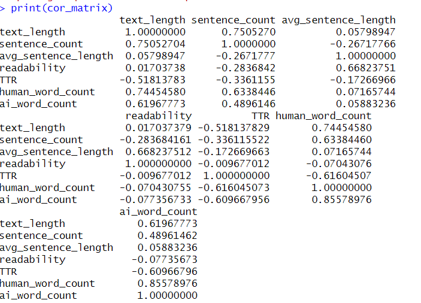

On supprime les variables corrélées comme word_count.

On applique finalement la lda : 
```R
lda_model <- lda(label ~ ., data = data_balanced_sample_cleaned)

```
On obtient les résultats suivants : 
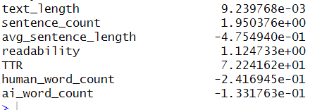

On conserve les résultats avec les valeurs les plus élevées : 
```R
data_balanced_selected <- data_balanced_sample_cleaned[, c("label", "TTR","ai_word_count","perplexity","sentence_count")]

```


# 5 Classification bayésienne

La classification bayésienne repose sur le théorème de Bayes, qui permet de calculer la probabilité qu'un document appartienne à une classe donnée, étant donné les caractéristiques extraites. Nous avons utilisé un modèle Naive Bayes pour classifier les textes en fonction de leur probabilité d'être générés par l'homme ou l'IA.

Afin mettre en œuvre une stratégie de validation robuste, on met en place la validation croisée stratifiée k-fold, pour garantir la généralisabilité du modèle.
```R
# Configuration de la validation croisée stratifiée k-fold
set.seed(123)
train_control <- trainControl(
  method = "cv",
  number = 5,
  classProbs = TRUE,
  summaryFunction = twoClassSummary
)

# Correction explicite pour caret (labels AI vs Human)
data_balanced_selected$label <- as.factor(ifelse(data_balanced_selected$label == 1, "AI", "Human"))

# Entraînement du modèle Naïve Bayes avec validation croisée
nb_model_cv <- train(
  label ~ ., 
  data = data_balanced_selected,
  method = "naive_bayes",
  trControl = train_control,
  metric = "ROC"
)
```

On entraine ensuite le modèle sur les données de test : 
```R
# Appliquer le modèle sur le jeu de test
test_data$label <- as.factor(ifelse(test_data$label == 1, "AI", "Human"))

test_predictions <- predict(nb_model_cv, newdata = test_data)
test_probabilities <- predict(nb_model_cv, newdata = test_data, type = "prob")

```

# 6 Evaluation et résultats

Pour observer les résultats, on affiche la matrice de confusion, la courbe ROC, l'AUC et le score Brier.

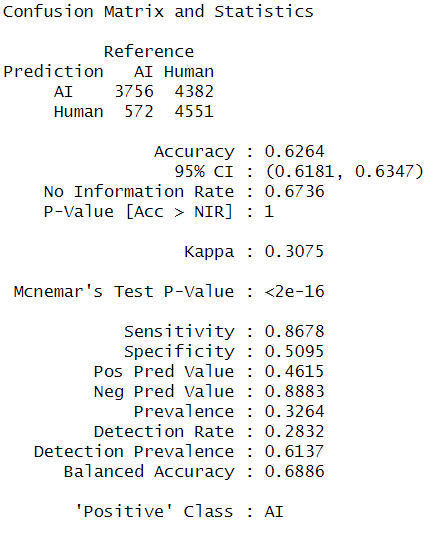

L'accuracy indique que le modèle est corecte dans 63% des cas. La sensitivity indique que le modèle détecte correctement environ 86.78 % des cas positifs (texte écris par un humain).
La spécifitité indique modèle détecte correctement environ 50.95%  des cas négatifs (texte écrit par un llm).
Le Kappa (0.3075) indique un accord faible entre les prédictions et la réalité au-delà du simple hasard.

AUC (Test Set): 0.7657952
L'AUC est correcte.

Brier Score (Test Set): 0.3370932

"F1-score:  0.6026"

# 7 Conclusion

L'analyse a démontré que l'extraction de caractéristiques linguistiques et stylométriques telles que la longueur des textes, les scores de lisibilité, le Type-Token Ratio (TTR) et la perplexité permet de discriminer partiellement les textes générés par une IA et ceux écrits par des humains. L'utilisation de l'Analyse Factorielle Discriminante (AFD) a été une étape essentielle pour réduire la dimensionnalité tout en conservant les caractéristiques discriminantes pertinentes.

L'application d'un modèle de classification bayésienne a donné des résultats prometteurs avec une AUC de 0.7658. Cependant, l'accuracy de 63% et la spécificité relativement faible (50.95%) montrent que le modèle a tendance à sous-performer dans la détection des textes générés par des IA. Cela est certainement du a leur sous représentation dans les données d'entrainements. La sensibilité plus élevée (86.78%) indique une meilleure capacité à identifier les textes humains. 

Ces résultats contrastés sont certainement du aux limitations suivantes : 

1- Déséquilibre des classes : 

Le déséquilibre initial des classes a pu biaiser les résultats. Bien que des techniques de sous-échantillonnage aient été appliquées, une solution plus robuste, comme l'oversampling ou l'utilisation de techniques de synthèse (SMOTE), pourrait améliorer la performance du modèle.

2- Variables corrélées :

 Certaines caractéristiques telles que "word_count" ont été éliminées en raison de corrélations élevées, ce qui peut avoir diminué la capacité discriminante du modèle.

3- Complexité des caractéristiques linguistiques :

 Les variables utilisées sont limitées à des caractéristiques linguistiques simples. Une analyse plus approfondie intégrant des vecteurs de mots (embeddings) ou des caractéristiques contextuelles pourrait être bénéfique.

4- Performances variables du modèle bayésien :

 Les hypothèses simplificatrices du Naive Bayes (indépendance entre les variables) peuvent limiter sa capacité à capturer des relations complexes entre les caractéristiques.

# 8 Travaux futurs
1- Intégration de modèles avancés :

 Explorer des modèles plus sophistiqués tels que les réseaux de neurones ou des architectures de type transformers pour capturer des relations contextuelles complexes dans les textes. Nous n'avons pas réussi à implémenter ces méthodes car nous n'avons pas réussi à importer les packages nécessaires. 

2- Extraction avancée des caractéristiques :

 Incorporer des techniques de NLP telles que les embeddings (Word2Vec, BERT) pour mieux représenter les textes. Nous n'avons pas réussi à incorporer ces techniques car elles sont très longues à executer et nous n'avons pas eu le temps d'aboutir notre code. 

3- Techniques de rééchantillonnage :

 Tester d'autres méthodes pour pallier le déséquilibre des classes et renforcer la robustesse du modèle.

4- Amélioration de la gestion de la perplexité : 

Optimiser les calculs de perplexité avec des approches plus précises comme les modèles n-grams conditionnels pour mieux représenter la structure du texte.
